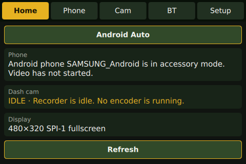
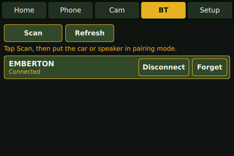
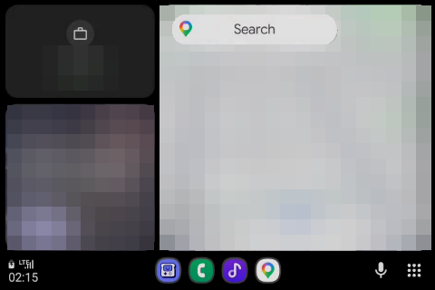
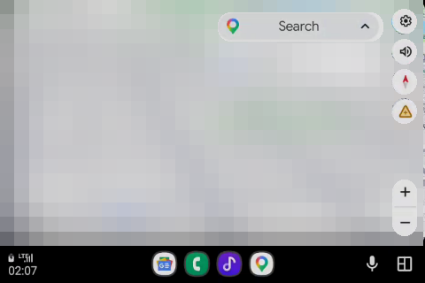

# pi-carplay

[](https://github.com/kagamirudo/pi-carplay/actions/workflows/ci.yml)
[](https://github.com/kagamirudo/pi-carplay/actions/workflows/soak.yml)
[](https://github.com/kagamirudo/pi-carplay/releases/latest)
[](LICENSE)

**A DIY car head unit on a Raspberry Pi 5.** Wired Android Auto on a 3.5″ touchscreen, a touch-friendly Qt 6 shell, and Bluetooth audio to your car stereo. The goal is a mirror-mounted unit with a forward dash cam.

<table align="center">
  <tr>
    <td align="center"><br><sub>Head-unit shell: home page</sub></td>
    <td align="center"><br><sub>Head-unit shell: Bluetooth devices</sub></td>
  </tr>
  <tr>
    <td align="center"><br><sub>Android Auto on the panel: dashboard</sub></td>
    <td align="center"><br><sub>Android Auto on the panel: full-screen Maps</sub></td>
  </tr>
</table>

<p align="center"><sub>Real 480×320 captures from the SPI panel. Map tiles, places and media details in the Android Auto shots are pixelated for privacy.</sub></p>

The phone plugs into the Pi over USB. Android Auto runs full-screen on the panel, and touch goes back to the phone. Sound goes to the car's existing stereo over Bluetooth, so the factory radio stays where it is.

## Features

| | Status |
| --- | --- |
| **Wired Android Auto**: OpenAuto + aasdk, patched for a 480×320 panel | ✅ Working |
| **Touch input**: calibrated resistive touch, mapped into the Android Auto content area | ✅ Working |
| **Head-unit shell**: Qt 6 / QML pages for Home, Phone, Cam, Bluetooth and Setup | ✅ Working |
| **Switching**: Android Auto **Exit** returns to the shell, and the shell's **Android Auto** button goes back | ✅ Working |
| **Bluetooth audio**: scan, pair (PIN `0000`/`1234` handled automatically), connect, route PipeWire output | ✅ Tested with a speaker |
| **Autostart**: shell plus Android Auto at login | ✅ Working |
| **Dash cam** (Camera Module 3) | 🟡 Camera verified, recorder not built yet |
| **Wireless Android Auto** | ⏳ Planned |
| **CarPlay** (needs an MFi-certified adapter) | ⏳ Planned |
| **Printed mirror-mount housing** | ⏳ Planned |

## Hardware

| Part | Notes |
| --- | --- |
| Raspberry Pi 5 (4 GB+) | Debian 12 "Bookworm" (Raspberry Pi OS) |
| 3.5″ SPI touchscreen hat, 480×320 | ILI9486 + ADS7846 (Waveshare 3.5″ / PiScreen pinout) |
| Raspberry Pi Camera Module 3 | For the dash cam |
| Official active cooler | |
| **5 V / 5 A USB-C power supply** | Required. See [Troubleshooting](docs/troubleshooting.md#white-screen-random-reboots) |
| Android phone + USB cable | Android Auto app installed |

Details, pinout and driver notes are in [`raspi-headunit/docs/hardware.md`](raspi-headunit/docs/hardware.md).

## Quick start

### Option A: install the release package

On Raspberry Pi OS Bookworm (64-bit, desktop), as the desktop user:

```sh
VERSION=0.1.0
wget https://github.com/kagamirudo/pi-carplay/releases/download/v$VERSION/pi-carplay_${VERSION}_arm64.deb
sudo apt install ./pi-carplay_${VERSION}_arm64.deb
pi-carplay-setup --boot     # labwc touch and autostart for this user, display overlay
sudo reboot
```

The package installs to `/opt/pi-carplay` and adds `pi-carplay-setup`, `pi-carplay-restart`, `pi-carplay-boot-config` and `pi-carplay-selftest`. All files are on the [releases page](https://github.com/kagamirudo/pi-carplay/releases), with a `SHA256SUMS` file and the GPL source tarball.

### Option B: build from source

```sh
git clone https://github.com/kagamirudo/pi-carplay.git ~/CarPlay
cd ~/CarPlay
make deps          # apt packages (sudo)
make build         # h264bitstream, aasdk, OpenAuto (patched) and the shell
make test          # unit, UI, stress, smoke and script tests (no Pi hardware needed)
make install       # udev rule, labwc touch and autostart, OpenAuto config, restart script
make boot-config   # SPI display overlay in /boot/firmware/config.txt
sudo reboot
```

After the reboot the panel shows the shell. Plug in the phone and Android Auto takes over the screen.

`make help` lists every target. The full walkthrough is in [docs/installation.md](docs/installation.md).

## Using it

| To… | Do this |
| --- | --- |
| Start Android Auto | Plug in the phone. It switches to accessory mode and projection starts. |
| Get back to the shell | In Android Auto, open the app grid (⋮⋮) and tap **Exit**. |
| Return to Android Auto | Shell **Home** → **Android Auto** |
| Connect the car stereo | Shell **BT** → **Scan** → put the car in pairing mode → **Connect** |
| Recover from a frozen or black screen | `pi-carplay-restart` (package) or `make restart` (source) |
| Check health | `pi-carplay-selftest` (package) or `make selftest` (source) |

More detail is in [docs/usage.md](docs/usage.md).

## Reliability

The shell and Android Auto run under a supervisor that restarts them if they ever exit, and records each crash. A corrupt settings file, a missing Bluetooth service or a power cut mid-save cannot stop the head unit from starting.

Every pull request and release goes through the same gates: `-Werror` builds, shellcheck, cppcheck and qmllint, unit, D-Bus integration, UI and smoke tests, a seeded UI monkey test, config fuzzing, AddressSanitizer and UBSan, a coverage floor, and a real install and purge of the `.deb` on a clean Bookworm. A nightly soak runs 100,000 random taps and 2,000,000 fuzz cases. Releases also pass a hardware checklist on a real Pi. See [docs/quality.md](docs/quality.md) and [docs/testing.md](docs/testing.md).

```sh
make deps-qa && make check   # every gate CI runs, locally
```

## How it fits together

```
 Android phone ── USB (AOAP) ──► autoapp (OpenAuto + aasdk, patched)
                                   │  H.264 → Qt Multimedia → crop 720×480 → scale ×2/3
                                   ▼
            labwc (Wayland) ──► SPI-1: ILI9486 480×320 panel ◄── ADS7846 touch
                                   ▲
 headunit (Qt 6 / QML shell) ──────┘   Home · Phone · Cam · BT · Setup
     │  SIGUSR1 "show Android Auto"        ▲ Android Auto "Exit" hides projection
     └─ BlueZ (D-Bus agent, bluetoothctl) ─► car stereo / speaker (A2DP via PipeWire)
```

More detail is in [docs/architecture.md](docs/architecture.md).

## Repository layout

| Path | What |
| --- | --- |
| `Makefile` | One-command dependencies, build, test, install, boot config and packaging |
| `packaging/` | `.deb` builder, package scripts and Debian copyright file |
| `.github/workflows/` | Quality pipeline on arm64, nightly soak, tag-triggered releases |
| `tests/scripts/` | bats tests for the supervisor, launcher and setup scripts |
| `tools/` | `pi-carplay-selftest`, the on-device health check |
| `raspi-headunit/` | The head-unit shell: C++20, Qt 6.4, QML, CMake, unit tests |
| `patches/` | **GPL-3.0** patches for OpenAuto and aasdk, pinned to upstream commits |
| `deploy/` | Files `make install` puts on the system: udev rule, labwc config, autostart, OpenAuto config, restart script |
| `docs/` | Installation, usage, architecture, troubleshooting, quality policy, testing, releasing |
| `docs/plans/` | Numbered design plans, starting with the [original project plan](docs/plans/0001-pi5-head-unit-and-dash-cam.md) |
| `CONTRIBUTING.md` | How changes get in |
| `CHANGELOG.md` | Release history |
| `scripts/` | Bring-up tools, such as a raw touch and panel test canvas |

## Licensing

- **This repository** (shell, scripts, deploy files, docs): [MIT](LICENSE).
- **`patches/`**: GPL-3.0, because they modify [OpenAuto](https://github.com/openDsh/openauto) and [aasdk](https://github.com/openDsh/aasdk), which are GPL-3.0. The built `autoapp` binary is GPL-3.0. The shell talks to it only through a process signal and a shared screen, and does not link to it.
- Android Auto is a trademark of Google LLC. CarPlay is a trademark of Apple Inc. This project is not affiliated with either. CarPlay support will only use an MFi-certified adapter. There is no MFi bypass.

## Acknowledgements

- [openDsh/openauto](https://github.com/openDsh/openauto) and [openDsh/aasdk](https://github.com/openDsh/aasdk), the Android Auto receiver this project builds on (originally by f1x.studio)
- [aizvorski/h264bitstream](https://github.com/aizvorski/h264bitstream)
- The Raspberry Pi kernel `ili9486` DRM driver and the `piscreen` overlay
